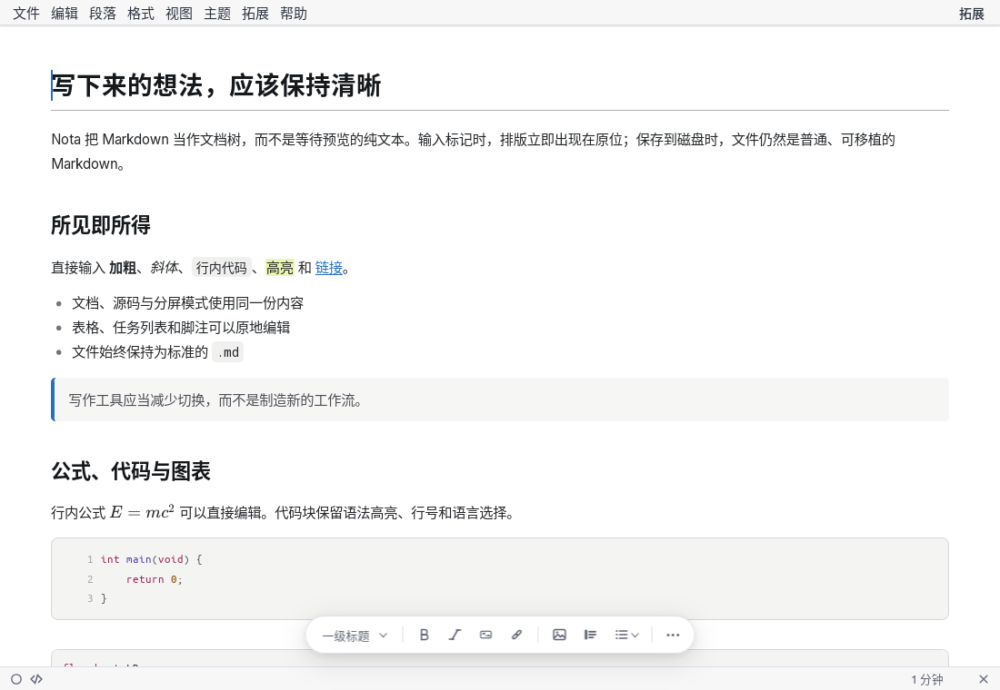
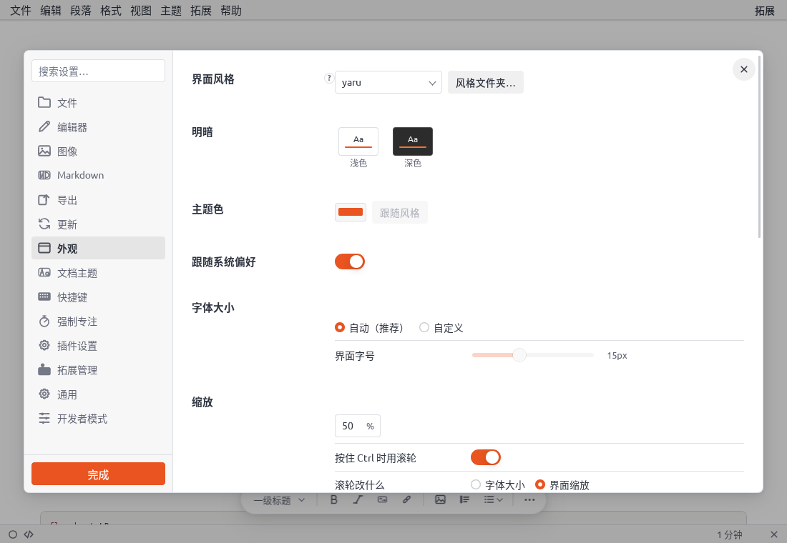
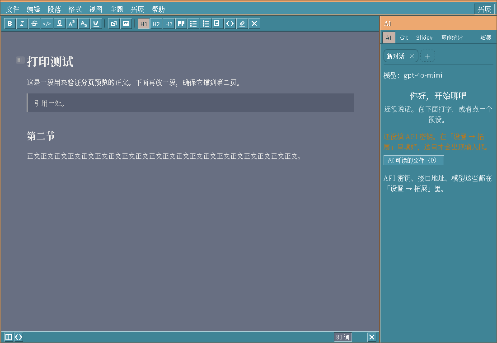

<p align="center">
  
</p>

<h1 align="center">Nota</h1>

<p align="center">
  Write Markdown. See the document.
</p>

<p align="center">
  A local-first, WYSIWYG Markdown editor built with Tauri, Milkdown and Lua.
</p>

<p align="center">
  <a href="README.zh-CN.md">简体中文</a> ·
  <a href="https://github.com/Nota-MD/Nota/releases">Download</a> ·
  <a href="https://nota-md.github.io/">Website</a> ·
  <a href="https://nota-md.github.io/docs/">Documentation</a>
</p>

<p align="center">
  <a href="https://github.com/Nota-MD/Nota/releases">
    
  </a>
  <a href="LICENSE">
    
  </a>
  <a href="https://github.com/Nota-MD/Nota/releases">
    
  </a>
  <a href="https://github.com/Nota-MD/Nota-plugins">
    
  </a>
  <a href="https://github.com/Nota-MD/Nota-themes">
    
  </a>
</p>



## Why Nota

Nota treats Markdown as a document tree instead of a text buffer. Formatting appears
as you type, while the file on disk remains ordinary, portable Markdown.

Your notes stay readable in another editor, understandable in a diff, and usable
for decades without a proprietary database.

## What makes it different

| | |
|---|---|
| **True WYSIWYG** | Headings, emphasis, lists, quotes, code, math and diagrams render in place. Source and split modes remain available. |
| **GitHub Markdown** | GitHub Flavored Markdown, footnotes with two-way navigation, all five alert types, task lists, badges, math and Mermaid 12 are supported. |
| **GitHub Docs compatibility** | Named anchors, `<kbd>` keys, ``, common Octicons, data variables and reusable tokens are rendered without executing Liquid; document checks catch missing alt text and structural issues. |
| **Plain files** | Every document is saved as standard `.md`. There is no hidden JSON layer or private document format. |
| **A real workspace** | Tabs, folder tree, outline, autosave, external-change detection and distraction-free writing modes share one focused interface. |
| **Extensible in Lua** | AI, Git, presentation and writing-statistics extensions are installed separately and receive capabilities from an explicit manifest. |
| **Interface and document themes** | The shell and the document are independent visual axes. Interface themes can provide their own CSS, icons and fonts. |
| **Native desktop packaging** | Linux and Windows packages are built from the same Rust and React codebase. |
| **Verified updates** | Experimental application updates select the correct package kind; extensions can check their declared `latest.json` repositories. |
| **Proxy-aware downloads** | Debug-only prefix replacement rules can route application and extension update downloads through a mirror. |

## Interface themes

<table>
  <tr>
    <td width="50%"></td>
    <td width="50%"></td>
  </tr>
  <tr>
    <td align="center">Yaru, the default presentation used on the website</td>
    <td align="center">CDE-inspired external theme</td>
  </tr>
</table>

Interface themes and document themes are maintained in the official
[Nota-themes](https://github.com/Nota-MD/Nota-themes) repository. Install a theme
from **Settings → Appearance → Styles folder** or from the documented theme directories.

## Official repositories

| Repository | Purpose |
|---|---|
| [Nota](https://github.com/Nota-MD/Nota) | Desktop application, core editor and documentation |
| [Nota-plugins](https://github.com/Nota-MD/Nota-plugins) | Official Lua extensions: AI, Git, Slidev and writing statistics |
| [Nota-themes](https://github.com/Nota-MD/Nota-themes) | Official interface and document themes |
| [Nota-docs](https://github.com/Nota-MD/Nota-docs) | Online user and developer documentation |
| [nota-md.github.io](https://github.com/Nota-MD/nota-md.github.io) | Project website |

## Install

Download the package for your platform from
**[GitHub Releases](https://github.com/Nota-MD/Nota/releases)**.

The release builds include Linux packages and Windows installers.
Official extensions and themes are installed separately.

> Windows support is new and has received limited testing. Bug reports, compatibility
> details and suggestions are welcome in
> [GitHub Issues](https://github.com/Nota-MD/Nota/issues).

## Build from source

Requirements: Rust 1.85 or newer and Node.js. Linux uses WebKitGTK 4.1;
Windows uses Microsoft Edge WebView2 (Chromium), not WebKitGTK.

```sh
npm install
npm run app
```

Useful checks:

```sh
npm run typecheck
npm test
npm run build
cd src-tauri && cargo test --lib
```

Detailed platform dependencies and headless test recipes are in
[`docs/06-build-run-test.md`](docs/06-build-run-test.md).

## Project status

Nota is currently a beta. The authoritative feature and defect status is maintained in
[`docs/10-feature-matrix.md`](docs/10-feature-matrix.md) and
[`docs/07-feature-status.md`](docs/07-feature-status.md).

## Contributing

AI-assisted contributions are welcome. The person submitting a contribution must
understand it, verify its licensing, and personally complete the relevant tests.
See [`CONTRIBUTING.md`](CONTRIBUTING.md).

## License

Nota is released under the [BSD 2-Clause License](LICENSE). Third-party components
and assets are listed in [`THIRD-PARTY.md`](THIRD-PARTY.md).
