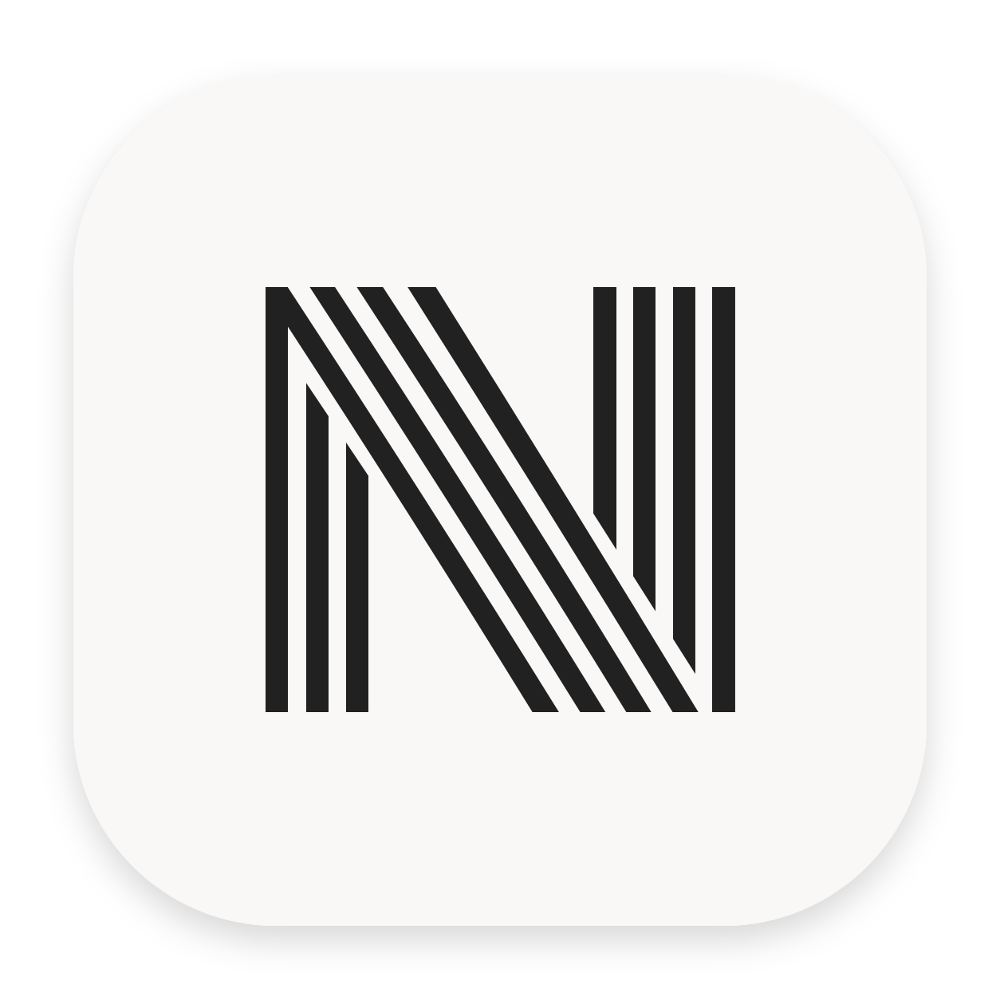
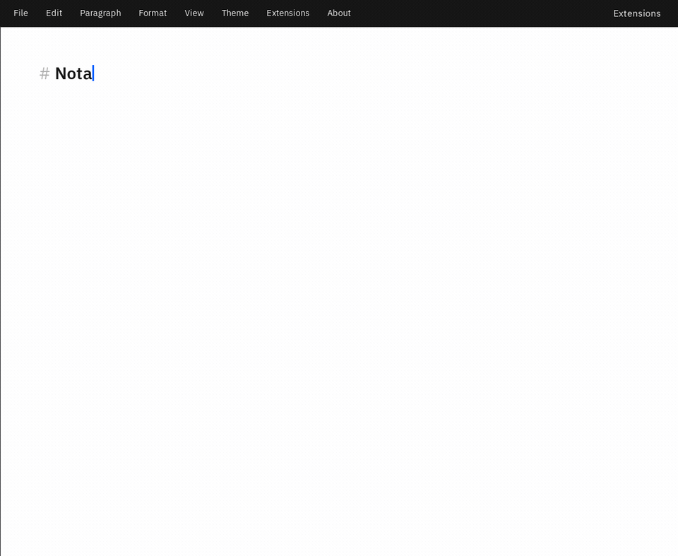
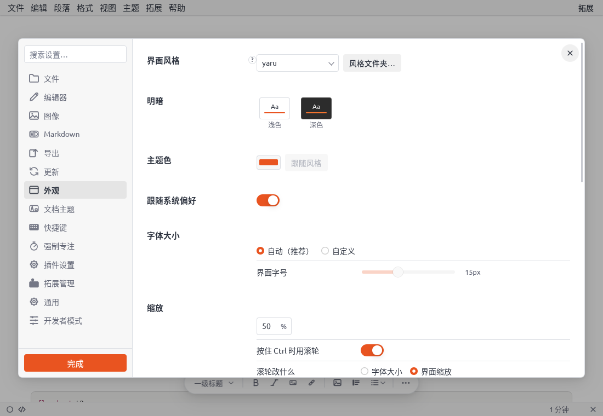
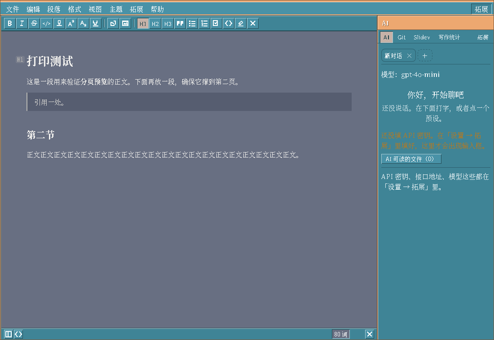

<p align="center">
  
</p>

<h1 align="center">Nota</h1>

<p align="center">
  写下 Markdown，也看见最终文档。
</p>

<p align="center">
  一款本地优先、所见即所得，并用 Lua 扩展的 Markdown 编辑器。
</p>

<p align="center">
  <a href="README.md">English</a> ·
  <strong>简体中文</strong> ·
  <a href="https://github.com/Nota-MD/Nota/releases">下载</a> ·
  <a href="https://nota-md.github.io/zh-CN.html">官网</a> ·
  <a href="https://nota-md.github.io/docs/">文档</a>
</p>

<p align="center">
  <a href="https://github.com/Nota-MD/Nota/releases">
    
  </a>
  <a href="LICENSE">
    
  </a>
  <a href="https://github.com/Nota-MD/Nota/releases">
    
  </a>
  <a href="https://github.com/Nota-MD/Nota-plugins">
    
  </a>
  <a href="https://github.com/Nota-MD/Nota-themes">
    
  </a>
</p>

<p align="center">
  
</p>

## 为什么是 Nota

Nota 把 Markdown 当作一棵文档树，而不是一段等待预览的纯文本。输入标记时，排版
立即出现在原位；保存到磁盘时，文件仍然是普通、可移植的 Markdown。

文档可以用别的编辑器打开，可以在 Git diff 中正常阅读，也可以脱离 Nota 长期保存。

## 主要特性

| | |
|---|---|
| **真正的所见即所得** | 标题、强调、列表、引用、代码、公式和图表原位排版，同时保留源码与分屏模式。 |
| **GitHub Markdown** | 支持 GFM、脚注、提示块、任务列表、徽章、公式与 Mermaid，并可直接加载 HTTPS/HTTP 远程图片。 |
| **纯文件** | 每份文档都是标准 `.md`，没有私有 JSON 中间层，也没有锁定格式。 |
| **完整写作工作区** | 标签页、文件树、大纲、自动保存、外部修改检测与专注写作模式共用一套克制界面。 |
| **Lua 拓展** | AI、Git、Slidev、写作统计、Vim 与知识图谱独立安装，并通过清单获得明确授权的能力。 |
| **界面与文档双主题** | 外壳与正文分别控制；界面主题可以提供自己的 CSS、图标和字体。 |
| **原生桌面分发** | Linux 和 Windows 安装包由同一套 Rust 与 React 代码构建。 |
| **可校验更新** | 实验性应用更新会按安装包类型选择资产；拓展可检查其声明的 `latest.json` 仓库。 |
| **下载替换** | 「设置 → 通用 → 下载」可配置地址前缀替换，将应用和拓展更新流量导向镜像。 |

## 界面风采

<table>
  <tr>
    <td width="50%"></td>
    <td width="50%"></td>
  </tr>
  <tr>
    <td align="center">官网采用的 Yaru 界面风格</td>
    <td align="center">CDE 风格外置主题</td>
  </tr>
</table>

界面主题与文档主题统一维护在官方
[Nota-themes](https://github.com/Nota-MD/Nota-themes) 仓库。可在
**设置 → 外观 → 风格文件夹**或文档说明的主题目录中安装。

## 官方仓库

| 仓库 | 用途 |
|---|---|
| [Nota](https://github.com/Nota-MD/Nota) | 桌面应用、编辑器内核与文档 |
| [Nota-plugins](https://github.com/Nota-MD/Nota-plugins) | 官方 Lua 拓展：AI、Git、Slidev、写作统计、Vim 与知识图谱 |
| [Nota-themes](https://github.com/Nota-MD/Nota-themes) | 官方界面主题与文档主题 |
| [Nota-devkit](https://github.com/Nota-MD/Nota-devkit) | 带认证的开发者桥客户端、校验器与实时预览 |
| [Nota-docs](https://github.com/Nota-MD/Nota-docs) | 在线用户文档与开发者文档 |
| [nota-md.github.io](https://github.com/Nota-MD/nota-md.github.io) | 项目官网 |

## 安装

从 **[GitHub Releases](https://github.com/Nota-MD/Nota/releases)** 下载对应平台的安装包。

Release 包含 Linux、Windows 与未签名 macOS 的正式打包产物。官方拓展和主题需要单独安装。

### 安装未签名的 macOS 包

当前 macOS 构建未签名，也未经过公证，因此首次启动可能被 Gatekeeper 拦截。
仅应对从 Nota 官方 Release 下载、且已核对 `SHA256SUMS.txt` 的包解除隔离。

1. 打开 DMG，将 **Nota.app** 拖入 **Applications（应用程序）**。
2. 在“应用程序”中按住 Control 点击 **Nota**，选择 **打开**，再确认 **打开**。
3. 若仍被拦截，打开 **系统设置 → 隐私与安全性**，在 Nota 一项选择 **仍要打开**。
4. 也可以使用终端：

```sh
xattr -dr com.apple.quarantine /Applications/Nota.app
```

## 从源码运行

依赖：Rust 1.85 或更高版本、Node.js。Linux 使用 WebKitGTK 4.1；
Windows 使用 Microsoft Edge WebView2（Chromium），不使用 WebKitGTK。

```sh
npm install
npm run app
```

常用检查：

```sh
npm run verify:light
npm run verify:full
```

轻量档用于日常云端检查；完整档还会运行浏览器 E2E、Rust 全集、文档漂移检查和生产构建。

各平台的系统依赖与无头测试流程见
[`docs/06-build-run-test.md`](docs/06-build-run-test.md)。

## 项目状态

Nota 当前处于 Beta。功能完成度与缺陷状态以
[`docs/10-feature-matrix.md`](docs/10-feature-matrix.md) 和
[`docs/07-feature-status.md`](docs/07-feature-status.md) 为准。

## 贡献

Nota 明确欢迎 AI 辅助贡献。提交者必须理解所提交内容、确认许可证，并亲自完成相关测试。
规则见 [`CONTRIBUTING.md`](CONTRIBUTING.md)。

## 许可证

Nota 使用 [BSD 2-Clause License](LICENSE)。第三方组件与资源的来源和许可见
[`THIRD-PARTY.md`](THIRD-PARTY.md)。
