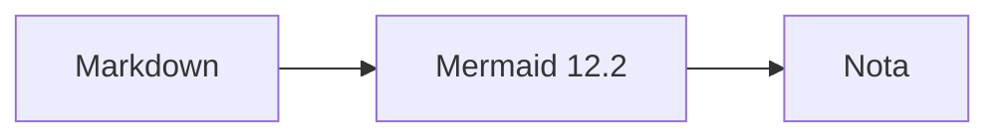
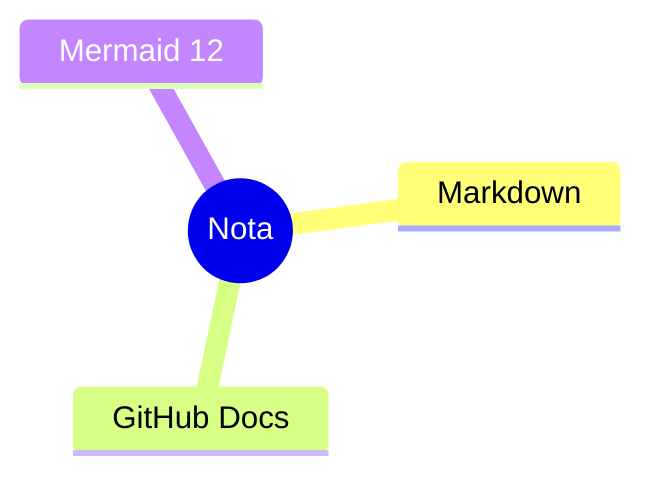

# Nota 0.12.0 smoke test

## GitHub alert

> [!NOTE]
> This is a GitHub alert inserted from the editor.

## Footnote

GitHub style guide footnote[^one].

[^one]: Footnote definition with two-way navigation.

## Keyboard

<kbd>Ctrl</kbd>+<kbd>B</kbd>

## Row headers


| Permission | Reader | Writer |
| --- | --- | --- |
| View |  |  |
| Edit |  |  |


## Liquid data



## Mermaid

